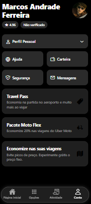

# Uber Mock — Expo

Aplicativo híbrido inspirado no ecossistema **Uber** (Mobilidade, Envios e iFood), desenvolvido em React Native com Expo como projeto da disciplina **Laboratório de Desenvolvimento de App Híbrido**.

O objetivo do projeto é reconstruir a experiência de interface, navegação multi-fluxo, persistência local e integração resiliente com APIs REST.

## 📱 Sobre o projeto

- **Framework:** React Native + Expo (Expo Router)
- **Linguagem:** TypeScript
- **Navegação:** Stack raiz + grupos `(auth)` e `(app)` + Tabs (`Página inicial`, `Opções`, `Atividade`, `Conta`) + Modais e Rotas Dinâmicas (**18 telas funcionais**)
- **Autenticação e Persistência Local:** `AsyncStorage` via hook customizado `useArmazenamento` (sessão, usuários cadastrados, tema, histórico de viagens, pedidos, envios, endereços e carteira)
- **Tema:** Claro e escuro, com alternância dinâmica e persistência no aparelho
- **Consumo de API:** Integração REST com `fetch`, `AbortController` (timeout) e tratamento completo de estados (`loading`, `erro`, `vazio` e modo offline)

## ✨ Funcionalidades

### Autenticação & Conta
- **Cadastro e Login protegidos:** Criação de conta (`cadastro.tsx`) e autenticação (`login.tsx`) persistidas no `AsyncStorage`. Sem sessão ativa, qualquer tentativa de acessar rotas internas redireciona automaticamente para o login (`Redirect`).
- **Controle de histórico de navegação:** O login utiliza `router.replace('/home')` para impedir retorno à tela de autenticação, e o botão **Sair** encerra a sessão com segurança.
- **Perfil editável:** Edição de nome, e-mail, telefone e foto (por URL) refletida em tempo real em toda a interface via `AuthContext`.
- **Carteira:** Saldo simulado, listagem, adição e remoção de cartões salvos localmente.
- **Central de Ajuda:** FAQ expansível com perguntas frequentes.
- **Tema claro/escuro:** Alternado na tela Conta e salvo automaticamente no dispositivo.

### Mobilidade (Uber)
- **Motoristas (API):** Listagem na Home via `GET /users`, com *pull-to-refresh* e estados de carregamento, erro e vazio.
- **Detalhes e Avaliações:** Rota dinâmica `motorista/[id]` (`GET /users/:id` e `GET /users/:id/posts`) e modal dinâmico `avaliar/[id]` para envio de avaliações via `POST /posts`.
- **Fluxo de viagem completo:** Escolha de categoria (`pedir-viagem`), acompanhamento em tempo real (`acompanhar-viagem`) e recibo detalhado (`viagem/[id]`).
- **Endereços salvos:** Consulta automática de logradouro, bairro e cidade por CEP via **ViaCEP** e gerenciamento local.

### Delivery (iFood) & Envios
- **Catálogo iFood:** 11 estabelecimentos divididos em categorias (Restaurantes, Mercados, Farmácias, Bebida gelada, Pet Shops, Shopping, Gourmet, etc.) com busca textual em tempo real.
- **Carrinho Multi-lojas:** Cardápio dinâmico (`restaurante/[id]`), atalho de sacola na Home e carrinho (`carrinho.tsx`) capaz de acumular itens de diferentes lojas simultaneamente.
- **Uber Envios:** Solicitação de envio, recebimento ou retirada (`enviar.tsx`) com seleção de porte, cálculo dinâmico de valor e registro via API + armazenamento local.

### Atividade & Resiliência Offline
- **Histórico unificado:** Combina viagens, pedidos do iFood, envios salvos localmente e registros sincronizados da API (`GET /users/1/posts`) em uma `FlatList`.
- **Detecção de modo offline:** Exibe banner informativo em tempo real quando o dispositivo perde conexão, mantendo os dados salvos localmente acessíveis.
- **Layout responsivo:** Adaptação automática entre layout mobile (1 coluna) e desktop/web (múltiplas colunas).

## 💾 Persistência Local (`AsyncStorage`)

O projeto centraliza a leitura e gravação local no hook genérico `src/hooks/useArmazenamento.ts`, persistindo:

| Chave | Conteúdo Armazenado |
| :--- | :--- |
| `@uber_sessao_usuario` | Sessão do usuário autenticado |
| `@uber_usuarios_cadastrados` | Contas criadas na tela de cadastro |
| `@uber_tema_modo` | Preferência de tema (`claro` ou `escuro`) |
| `@uber_viagens` | Histórico de corridas concluídas e canceladas |
| `@ifood_carrinho` | Itens ativos no carrinho multi-lojas |
| `@ifood_pedidos` | Histórico de pedidos finalizados no iFood |
| `@uber_envios` | Histórico de solicitações do Uber Envios |
| `@uber_enderecos` | Endereços salvos pelo usuário |

## 🌐 Consumo da API

O aplicativo consome a API REST **JSONPlaceholder** para simular operações de listagem, detalhamento e criação de registros, além da API pública **ViaCEP** para consulta real de endereços.

### Configuração e URL Base
- **URL Padrão API:** `https://jsonplaceholder.typicode.com` (`EXPO_PUBLIC_API_URL`)
- **URL Padrão ViaCEP:** `https://viacep.com.br/ws` (`EXPO_PUBLIC_VIACEP_URL`)

### Endpoints Consumidos
- `GET /users`: Lista os motoristas parceiros na Home e sorteia motoristas para as corridas.
- `GET /users/:id`: Busca dados detalhados de um motorista na tela `motorista/[id]`.
- `GET /users/:id/posts`: Busca avaliações do motorista e registros de atividade sincronizados.
- `POST /posts`: Registra novas viagens, pedidos do iFood, envios e avaliações de motoristas.
- `GET https://viacep.com.br/ws/{cep}/json/`: Consulta endereços reais a partir do CEP.

### Camada de Serviços e Hook `useFetch`
- **Serviço Centralizado (`src/services/api.ts`):** Função genérica `req<T>` com validação de status HTTP (`404`, erros de servidor/rede) e *timeout* de 10 segundos via `AbortController`.
- **Hook `useFetch` (`src/hooks/useFetch.ts`):** Gerencia os estados `dados`, `loading` e `erro`, evitando *race conditions* e atualizações em componentes desmontados.

## ⚙️ Variáveis de Ambiente

```env
EXPO_PUBLIC_API_URL=https://jsonplaceholder.typicode.com
EXPO_PUBLIC_VIACEP_URL=https://viacep.com.br/ws
```

O arquivo `.env.example` contém o template padrão. Caso o `.env` não seja criado, os valores acima são utilizados automaticamente como *fallback*.

## 🧪 Testando os Estados da Aplicação (Modo Avião)

### No Celular Físico ou Emulador
1. Abra o aplicativo com internet ativa para carregar o bundle inicial.
2. Ative o **Modo Avião** ou desligue Wi-Fi e dados móveis.
3. **Na Home / Detalhes / Avaliações / ViaCEP:** Puxe para atualizar (*pull-to-refresh*) ou tente buscar um CEP para visualizar o componente `EstadoErro` com opção de retentativa (**"Tentar de novo"**).
4. **Na aba Atividade:** Os dados salvos localmente continuam disponíveis e, ao recarregar sem rede, o app exibe o tratamento de erro ou o banner de modo offline.
5. Desative o Modo Avião e toque em **"Tentar de novo"** para restabelecer a sincronização.

### No Navegador Web (Chrome / Edge / Firefox)
1. Pressione `F12` para abrir o **DevTools**.
2. Acesse a aba **Network** (Rede).
3. Altere o seletor de rede (*Throttling*) para **Offline** e teste o botão de atualizar (`↻`) na aba **Atividade** ou a busca de CEP em **Endereços**.

## 🖼️ Telas

### Login


### Página inicial (Home — Uber, Envios e iFood)


### Opções


### Atividade


### Conta


## 🧭 Fluxo de navegação

```
/                        → Redirect: com sessão vai para /home, sem sessão vai para /login
(auth)/login             → autenticação (router.replace('/home'))
(auth)/cadastro          → criação de nova conta com persistência local
(app)/_layout            → guarda de rota: sem sessão, Redirect para /login
(app)/(tabs)             → home (Uber | Envios | iFood), opcoes, atividade, conta
(app)/pedir-viagem       → solicitação de corrida por categoria
(app)/acompanhar-viagem  → acompanhamento em tempo real, conclusão e cancelamento
(app)/viagem/[id]        → recibo detalhado de viagem, pedido ou envio
(app)/motorista/[id]     → perfil e avaliações do motorista
(app)/avaliar/[id]       → modal de avaliação do motorista (POST /posts)
(app)/restaurante/[id]   → cardápio da loja e adição ao carrinho
(app)/carrinho           → carrinho multi-lojas e finalização de pedido
(app)/enviar             → formulário de solicitação do Uber Envios
(app)/enderecos          → endereços salvos com consulta ViaCEP
(app)/perfil             → edição de perfil
(app)/carteira           → saldo e gerenciamento de cartões
(app)/ajuda              → central de ajuda (FAQ)
```

## 🚀 Como rodar o projeto

Pré-requisito: [Node.js](https://nodejs.org/) instalado.

```bash
# Clone o repositório
git clone https://github.com/DanteZzzy/uber-mock-expo.git

# Entre na pasta do projeto
cd uber-mock-expo

# Instale as dependências
npm install

# (Opcional) Configure as variáveis de ambiente
cp .env.example .env

# Inicie o servidor de desenvolvimento
npx expo start
```

- **Web:** pressione `w` no terminal
- **Android:** pressione `a` no terminal ou escaneie o QR Code com o **Expo Go**
- **Celular via navegador (alternativa ao Expo Go):** acesse `http://SEU-IP-LOCAL:8081` conectado à mesma rede Wi-Fi

## 📂 Estrutura do projeto

```
src/
  app/
    _layout.tsx              # Stack raiz (TemaProvider + AuthProvider + CarrinhoProvider)
    index.tsx                # Redirecionamento inicial baseado na sessão
    (auth)/
      _layout.tsx
      login.tsx              # Tela de Login
      cadastro.tsx           # Tela de Cadastro
    (app)/
      _layout.tsx          # Guarda de autenticação + Stack interno
      (tabs)/
        _layout.tsx          # Barra de navegação inferior flutuante
        home.tsx             # Abas Uber, Envios e iFood
        opcoes.tsx           # Grade de serviços
        atividade.tsx        # Histórico unificado com FlatList e status offline
        conta.tsx            # Configurações, tema e logout
      pedir-viagem.tsx       # Pedido de corrida
      acompanhar-viagem.tsx  # Corrida em andamento
      restaurante/[id].tsx   # Cardápio do estabelecimento
      carrinho.tsx           # Carrinho multi-lojas
      enviar.tsx             # Solicitação de envio
      enderecos.tsx          # Endereços salvos (ViaCEP)
      viagem/[id].tsx        # Detalhes de viagem, pedido ou envio
      motorista/[id].tsx     # Perfil do motorista
      avaliar/[id].tsx       # Modal de avaliação
      perfil.tsx             # Edição de perfil
      carteira.tsx           # Carteira digital
      ajuda.tsx              # Central de Ajuda
  components/                # Componentes reutilizáveis (atividade, home, ifood, opcoes, etc.)
  context/
    AuthContext.tsx          # Autenticação e dados do usuário
    CarrinhoContext.tsx      # Estado global do carrinho multi-lojas
  data/                      # Dados mockados e constantes
  hooks/
    useArmazenamento.ts      # Wrapper genérico do AsyncStorage
    useFetch.ts              # Hook de requisições HTTP com controle de ciclo de vida
  services/
    api.ts                   # Cliente HTTP (JSONPlaceholder e ViaCEP)
  theme/                     # Paletas claro/escuro e TemaContext
  utils/                     # Formatação de moeda, data, telefone e CEP
  types.ts                   # Tipagens TypeScript do projeto
```

## 👥 Autores

- Gabriel Teixeira de Faria
- Igor de Oliveira Barata

## 📚 Disciplina

Laboratório de Desenvolvimento de Aplicativos Híbridos — 7°Período — Universidade de Vassouras