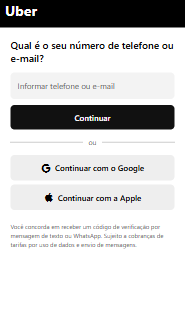

# Uber Mock — Expo

Aplicativo mockado do Uber, desenvolvido em React Native com Expo, como trabalho da disciplina **Laboratório de Desenvolvimento de App Híbrido**.

O objetivo do projeto não é reproduzir o backend ou a lógica real do app, e sim reconstruir a interface e a navegação entre as telas, com dados fictícios e integração com API REST.

## 📱 Sobre o projeto

- **Framework:** React Native + Expo (Expo Router)
- **Linguagem:** TypeScript
- **Navegação:** Stack raiz + grupos `(auth)` e `(app)` + Tabs (Página inicial, Opções, Atividade, Conta) + Modais e Telas de Detalhes
- **Autenticação simulada:** `AuthContext` com rotas protegidas via `Redirect`
- **Tema:** claro e escuro, com a escolha salva no aparelho (AsyncStorage)
- **Consumo de API:** REST API pública com `fetch`, timeout e tratamento de erros

## ✨ Funcionalidades

- **Login protegido:** sem entrar, nenhuma tela do app abre (quem tenta acessar `/home` é redirecionado ao login)
- **Entrar e sair:** o login leva à Home sem permitir voltar a ele (`router.replace`), e o botão **Sair**, na tela Conta, encerra a sessão
- **Motoristas (API):** listagem na Home via `GET /users`, com pull-to-refresh e estados de carregamento, erro e vazio
- **Detalhes do motorista:** rota dinâmica `motorista/[id]`, buscando dados via `GET /users/:id` com iniciais no avatar, informações de contato e empresa
- **Avaliar motorista:** modal dinâmico `avaliar/[id]` com envio de avaliação via `POST /posts`, estado de loading no botão e alerta de confirmação
- **Detalhe da viagem:** rota dinâmica `viagem/[id]`, aberta ao tocar em uma viagem da tela Atividade
- **Tema claro/escuro:** alternado por um botão na tela Conta, com a escolha mantida ao reabrir o app
- **Layout responsivo:** versão de celular em telas estreitas e versão com colunas em telas largas (web)

## 🌐 Consumo da API

O aplicativo consome uma API REST para listagem, consulta de detalhes e envio de avaliações dos motoristas.

### Configuração e URL Base
- **URL Padrão:** `https://jsonplaceholder.typicode.com`
- **Variável de Ambiente:** configurável através de `EXPO_PUBLIC_API_URL` no arquivo `.env` (exemplo disponível em `.env.example`).

### Endpoints Consumidos
- `GET /users`: Retorna a lista de motoristas exibidos no carrossel horizontal da tela inicial (`SecaoMotoristas`).
- `GET /users/:id`: Retorna as informações detalhadas de um motorista específico na tela `motorista/[id]` (e-mail, cidade, telefone, empresa e website).
- `POST /posts`: Envia a avaliação criada pelo usuário na tela/modal `avaliar/[id]`, enviando payload JSON (`{ title, body, userId }`) com cabeçalho `Content-Type: application/json; charset=UTF-8`.

### Camada de Serviços e Hook `useFetch`
- **Serviço Centralizado (`src/services/api.ts`):** Todas as chamadas utilizam a função `req<T>`, que implementa verificação de status HTTP (`404 Não encontrado`, erros de rede) e tempo limite de 10 segundos via `AbortController`.
- **Hook `useFetch` (`src/hooks/useFetch.ts`):** Gerencia reatividade dos estados `dados`, `loading` e `erro`, com suporte a cancelamento ao desmontar a tela, prevenção de respostas fora de ordem (`race conditions`), recarregamento manual (`recarregar`) e pull-to-refresh (`atualizar`).

## 🖼️ Telas

### Login



### Página inicial (Home)

A Home tem três abas no topo: **Uber**, **Envios** e **iFood**.


### Opções


### Atividade


### Conta


## 🧭 Fluxo de navegação

```
/                      → Redirect: com sessão vai para /home, sem sessão vai para /login
(auth)/login           → ao entrar: router.replace('/home')
(app)/_layout          → guarda: sem sessão, Redirect para /login
(app)/(tabs)           → home, opcoes, atividade, conta
(app)/viagem/[id]      → detalhe da viagem (abre por cima das abas)
(app)/motorista/[id]   → detalhe do motorista (abre ao tocar no card da Home)
(app)/avaliar/[id]     → avaliação do motorista (modal aberto a partir do detalhe)
```

> A sessão é mantida apenas em memória. Ao fechar o app ou recarregar a página no navegador, é preciso entrar novamente.

## 🚀 Como rodar o projeto

Pré-requisito: [Node.js](https://nodejs.org/) instalado.

```bash
# Clone o repositório
git clone https://github.com/DanteZzzy/uber-mock-expo.git

# Entre na pasta do projeto
cd uber-mock-expo

# Instale as dependências
npm install

# Inicie o servidor de desenvolvimento
npx expo start
```

Depois de rodar o `npx expo start`, escolha uma das opções:

- **Web:** pressione `w` no terminal
- **Android:** pressione `a` no terminal (requer emulador configurado) ou use o app **Expo Go** no celular
- **Celular (Expo Go):** escaneie o QR code com o app Expo Go, usando uma versão do Expo Go compatível com o SDK do projeto

### ⚠️ Rodando no celular (Expo Go) e a versão do SDK

Este projeto usa o **Expo SDK 57**. Cada versão do Expo Go suporta apenas um SDK, e a versão disponível nas lojas pode não ser compatível com ele. No **iPhone**, o Expo Go da App Store pode não abrir o projeto, e o app acusa que o projeto é incompatível e precisa ser atualizado.

Alternativa para testar no celular, sem o Expo Go:

1. Com o `npx expo start` rodando no computador, descubra o endereço IPv4 da máquina (no Windows, `ipconfig`).
2. No navegador do celular, **conectado à mesma rede Wi-Fi**, abra `http://SEU-IP:8081`.
3. Se não abrir, libere o Node.js no firewall do Windows para redes privadas.

## 📂 Estrutura do projeto

```
src/
  context/
    AuthContext.tsx        # Sessão do usuário (entrar / sair)
  app/
    _layout.tsx            # Stack raiz (TemaProvider + AuthProvider)
    index.tsx              # Decide: Home (com sessão) ou Login (sem sessão)
    (auth)/
      _layout.tsx
      login.tsx            # Tela de Login
    (app)/
      _layout.tsx          # Guarda: Redirect para o login + Stack
      (tabs)/
        _layout.tsx        # Barra de abas inferior
        home.tsx
        opcoes.tsx
        atividade.tsx
        conta.tsx
      viagem/
        [id].tsx           # Detalhe da viagem (rota dinâmica)
      motorista/
        [id].tsx           # Detalhe do motorista (rota dinâmica)
      avaliar/
        [id].tsx           # Modal de avaliação do motorista
  components/              # Componentes reutilizáveis
  data/                    # Dados mockados
  hooks/                   # Hooks customizados (useFetch)
  services/                # Integração com API REST (api.ts)
  theme/
    cores.ts               # Paleta do tema escuro
    temas.ts               # Paletas clara e escura
    TemaContext.tsx        # Tema ativo, alternância e persistência
```

## 👥 Autores

- Gabriel Teixeira de Faria
- Igor de Oliveira Barata

## 📚 Disciplina

Laboratório de Desenvolvimento de App Híbrido — Universidade de Vassouras
